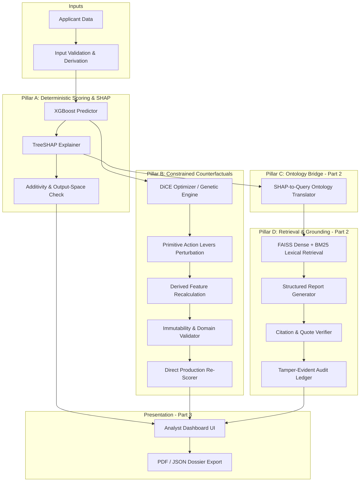

# XAI-RAG System Architecture

## Overview
XAI-RAG is a decision-auditing and explainability platform designed for enterprise credit risk systems. It addresses the enterprise ML "last-mile gap" where tabular models generate risk scores and SHAP provides local attributions, but analysts lack verified policy grounding, feasible remediation paths, and tamper-evident auditability.

## Core Architectural Principles

1. **Separation of Concerns & Single Source of Truth**:
   - The **XGBoost model** is the sole source of truth for predictions.
   - **SHAP** is the sole source of truth for feature attributions.
   - The **Policy Corpus** is the sole source of truth for regulations and guidelines.
   - The **LLM** (introduced in Part 2) acts strictly as a synthesis engine over verified evidence; it is never allowed to fabricate scores, probabilities, laws, citations, or counterfactuals.

2. **Mathematical Fidelity (P0 Gate)**:
   - All explanations and predictions must declare and respect their coordinate space (`log_odds` margin vs `probability`).
   - Additivity checks verify $base\_value + \sum \phi_i = raw\_margin$ in log-odds, and its calibrated or sigmoid probability equivalent.
   - Cross-space comparisons are rejected.

3. **Counterfactual Integrity (P0 Gate)**:
   - Candidates must never assume the optimizer's objective value; every candidate is directly re-evaluated using the exact production inference pipeline.
   - Immutable attributes (`AGE`, `PAST_DELINQUENCIES`, `CREDIT_BUREAU_SCORE`, `DAYS_EMPLOYED`, `AMT_INCOME_TOTAL`) cannot change to manufacture approvals.
   - Derived ratios (`FOIR_RATIO`, `LTV_RATIO`) are never perturbed independently; they are recomputed from updated primitives before scoring.

4. **Strict Typed Contracts**:
   - Every module interacts solely through versioned, strictly validated Pydantic v2 schemas forbidding unexpected fields (`extra='forbid'`).
